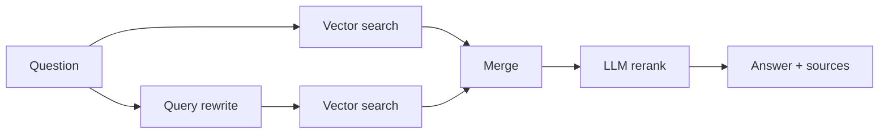

# Job Postings RAG

A retrieval-augmented generation (RAG) assistant that answers questions about a set of European job postings. Ask something like "Which companies want an assistant accountant in Thessaloniki?" and it returns an answer together with the postings it used.

- **Backend:** FastAPI, ChromaDB, sentence-transformers, LiteLLM (OpenRouter)
- **Frontend:** Next.js (TypeScript, Tailwind)
- **Evaluation:** golden set with retrieval metrics (MRR, nDCG, coverage) and LLM-as-a-judge answer scores

## How it works



1. **Ingestion:** each posting is split into chunks of about 330 tokens (40-token overlap), prefixed with title, company and location, embedded with `all-mpnet-base-v2` and stored in ChromaDB.
2. **Retrieval:** the question is searched as written and as an LLM-rewritten query. If it names a country, results are filtered to that country.
3. **Reranking:** an LLM reorders the merged chunks and the top 10 are kept.
4. **Answer:** the LLM answers from those chunks, and the API returns the answer with the source postings.

## Quick start (Docker)

Requirements: Docker Desktop and an [OpenRouter](https://openrouter.ai) API key.

```bash
git clone https://github.com/gthivaios/job-postings-rag.git
cd job-postings-rag
cp .env.example .env          # Windows PowerShell: Copy-Item .env.example .env
# open .env and set OPENROUTER_API_KEY
docker compose up --build
```

Open http://localhost:3000. The first start downloads the embedding model (about 400 MB) and builds the vector database, so it takes a few minutes.

## Local development

Requirements: Python 3.12, [uv](https://docs.astral.sh/uv/), Node.js 22.

**Backend**

```bash
cd backend
uv sync
uv run python -m scripts.ingest              # builds backend/job_postings_db
uv run uvicorn app.main:app --reload         # API on http://localhost:8000/docs
```

**Frontend** (in a second terminal)

```bash
cd frontend
npm install
npm run dev                                  # app on http://localhost:3000
```

The frontend reads the API address from `frontend/.env.local`:

```
NEXT_PUBLIC_API_URL=http://localhost:8000
```

## API

| Method | Path | Description |
| --- | --- | --- |
| GET | `/health` | Health check |
| POST | `/chat` | Answer a question; returns the answer and the source postings |
| GET | `/eval/report` | Latest evaluation report |

## Evaluation

The golden set (`backend/evaluation/golden_set.jsonl`) holds 20 questions, each with the job ids that should be retrieved and a description of a correct answer.

```bash
cd backend
uv run python -m evaluation.eval --all       # writes evaluation/report.json
uv run python -m evaluation.eval --test 3    # one test, with details
```

Results are shown at http://localhost:3000/eval.

| Metric | Score |
| --- | --- |
| MRR | _to fill from report.json_ |
| nDCG | _to fill_ |
| Coverage (%) | _to fill_ |
| Accuracy (1-5) | _to fill_ |
| Completeness (1-5) | _to fill_ |
| Relevance (1-5) | _to fill_ |

## Project structure

```
backend/
  app/            FastAPI app and RAG pipeline (app/rag/query.py)
  data/           documents.jsonl (job postings sample)
  evaluation/     golden set, metrics, evaluation script, report
  scripts/        ingestion and debugging scripts
  tests/          unit tests
frontend/
  app/            chat page and evaluation page
docker-compose.yml
```

## Data

`backend/data/documents.jsonl` contains about 1,000 job postings from Greece and other European countries, collected from public job portals and translated to English. They are included for demonstration only.

## License

The source code is released under the [MIT License](LICENSE). The job postings in `backend/data/` are not covered by this licence.
