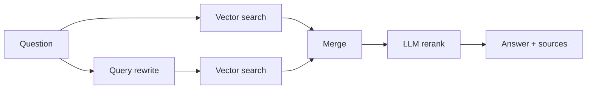

# Job Postings RAG

A retrieval-augmented generation (RAG) assistant that answers questions about a set of European job postings. Ask something like "Which companies want an assistant accountant in Thessaloniki?" and it returns an answer together with the postings it used.

- **Backend:** FastAPI, ChromaDB, sentence-transformers, LiteLLM (OpenRouter)
- **Frontend:** Next.js (TypeScript, Tailwind)
- **Evaluation:** golden set with retrieval metrics (MRR, nDCG, coverage) and LLM-as-a-judge answer scores

## How it works



All LLM calls go through LiteLLM to `openai/gpt-oss-120b` on OpenRouter (`MODEL` in `backend/app/rag/query.py`) and are retried with exponential backoff (10 s up to 240 s) if they fail.

### 1. Ingestion (`backend/scripts/ingest.py`)

Run once, before the API starts, to build the vector database.

- **Load:** reads `backend/data/documents.jsonl`, one posting per line with an `id`, the posting `text` and `metadata` (`job_id`, `portal`, `country`, `company`, `location`, `date`).
- **Clean metadata:** ChromaDB only accepts strings, numbers and booleans, so missing values become `""` and anything else is converted to a string.
- **Chunk:** `all-mpnet-base-v2` silently truncates input past 384 tokens, so each posting is split into chunks of at most 330 tokens. The splitter tries paragraph breaks first, then line breaks, sentences and words, and only cuts on raw tokens as a last resort. Consecutive chunks overlap by 40 tokens so content on a boundary is not lost.
- **Prefix:** every chunk starts with `Title: …`, `Company: …` and `Location: …`, so a chunk from the middle of a posting still says which job it belongs to. The prefix is counted against the 330-token budget.
- **Embed and store:** chunks are embedded with `sentence-transformers/all-mpnet-base-v2` and written to the `docs` collection in ChromaDB in batches of 500. Each chunk is stored with id `<doc_id>_chunk<n>` and keeps the posting metadata plus `doc_id`, `chunk_index`, `chunk_count` and `token_count`.

If the collection already has data the script leaves it as is; use `--rebuild` after changing the data or the chunking settings. The database path, collection name and data file can be changed with `CHROMA_PATH`, `CHROMA_COLLECTION` and `DOCUMENTS_PATH`.

### 2. Retrieval (`fetch_context` in `backend/app/rag/query.py`)

- **Country filter:** at startup the API reads every country in the collection. If the question mentions one of them (case-insensitive), the search is restricted to that country with a ChromaDB `where` filter. The original question is checked first, because the rewrite below may drop the country. If it names none, the rewritten query is checked instead, so a follow-up such as "more jobs in that country?" keeps the country from earlier in the conversation.
- **Query rewrite:** the LLM turns the question, together with the conversation so far, into a short search query focused on job title, skills, location, industry and seniority, without the conversational wording. This lets a follow-up such as "what about in Athens?" become a complete search query.
- **Two searches:** the original question and the rewritten query are each embedded with the same model and searched in ChromaDB, returning the 20 nearest chunks each.
- **Merge:** the two result lists are combined and duplicate chunks removed, giving up to 40 candidates.

### 3. Reranking (`rerank` in `backend/app/rag/query.py`)

Vector similarity alone often ranks loosely related postings highly, so the candidates are passed to the LLM together with the original question. It returns all the chunk ids ordered from most to least relevant, as structured output validated against a Pydantic model (`RankOrder`). The top 10 chunks are kept.

### 4. Answer (`answer_question` in `backend/app/rag/query.py`)

- **Prompt:** the 10 chunks are put into the system prompt, each labelled with its job id, company and location. The prompt tells the model to answer only from these excerpts, to say when it does not know, not to invent details such as salary, benefits or deadlines, and to name the job title and company when it refers to a posting.
- **Conversation:** the previous messages sent in the request's `history` (up to 20) are included, so follow-up questions work.
- **Response:** `POST /chat` returns the answer and a `sources` list with the job id, portal, company, location, country, date and text of each chunk used. The chat page lists these sources.

## Quick start (Docker)

Requirements: Docker Desktop and an [OpenRouter](https://openrouter.ai) API key.

```bash
git clone https://github.com/gthivaios/job-postings-rag.git
cd job-postings-rag
cp .env.example .env          # Windows PowerShell: Copy-Item .env.example .env
# open .env and set OPENROUTER_API_KEY
docker compose up --build
```

Open http://localhost:3000. The first start downloads the embedding model (about 400 MB) and builds the vector database, so it takes a few minutes.

## Local development

Requirements: Python 3.12, [uv](https://docs.astral.sh/uv/), Node.js 22.

**Backend**

```bash
cd backend
uv sync
uv run python -m scripts.ingest              # builds backend/job_postings_db
uv run uvicorn app.main:app --reload         # API on http://localhost:8000/docs
```

**Frontend** (in a second terminal)

```bash
cd frontend
npm install
npm run dev                                  # app on http://localhost:3000
```

The frontend reads the API address from `frontend/.env.local`:

```
NEXT_PUBLIC_API_URL=http://localhost:8000
```

## API

| Method | Path | Description |
| --- | --- | --- |
| GET | `/health` | Health check |
| POST | `/chat` | Answer a question; returns the answer and the source postings |
| GET | `/eval/report` | Latest evaluation report |

## Evaluation

The golden set (`backend/evaluation/golden_set.jsonl`) holds 20 questions, each with the job ids that should be retrieved and a description of a correct answer.

```bash
cd backend
uv run python -m evaluation.eval --all       # writes evaluation/report.json
uv run python -m evaluation.eval --test 3    # one test, with details
```

Results are shown at http://localhost:3000/eval.

| Metric | Score |
| --- | --- |
| MRR | 0.90 |
| nDCG | 0.86 |
| Coverage (%) | 85.61 |
| Accuracy (1-5) | 4.70 |
| Completeness (1-5) | 4.55 |
| Relevance (1-5) | 4.05 |

## Project structure

```
backend/
  app/            FastAPI app and RAG pipeline (app/rag/query.py)
  data/           documents.jsonl (job postings sample)
  evaluation/     golden set, metrics, evaluation script, report
  scripts/        ingestion and debugging scripts
  tests/          unit tests
frontend/
  app/            chat page and evaluation page
docker-compose.yml
```

## Data

`backend/data/documents.jsonl` contains about 1,000 job postings from Greece and other European countries, collected from public job portals and translated to English. They are included for demonstration only.

## License

The source code is released under the [MIT License](LICENSE). The job postings in `backend/data/` are not covered by this licence.
